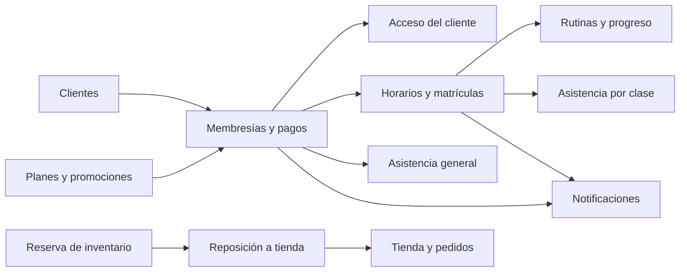

# Módulos implementados

Inventario del código de referencia `fc1577e`, levantado el 2026-10-29.
Los documentos son contratos de contexto para próximos cambios; su estado
«implementado» no equivale a una nueva aprobación de pruebas o despliegue.

| ID | Área | Valor actual | Contrato |
| --- | --- | --- | --- |
| MOD-01 | Identidad y acceso | Sesión con contraseña/Google y permisos por rol. | [Identidad](01-identidad-acceso.md) |
| MOD-02 | Clientes | Registro público/administrativo, edición y directorio. | [Clientes](02-clientes.md) |
| MOD-03 | Membresías y pagos | Cobro, activación, vigencia e historial. | [Membresías](03-membresias-pagos.md) |
| MOD-04 | Planes y promociones | Oferta, descuentos y cupos promocionales. | [Planes y promociones](04-planes-promociones.md) |
| MOD-05 | Horarios y matrículas | Programación semanal, inscripción y cupos. | [Horarios](05-horarios-matriculas.md) |
| MOD-06 | Asistencias | Entrada/salida general o por clase e historial privado. | [Asistencias](06-asistencias.md) |
| MOD-07 | Rutinas y progreso | Catálogo, asignación y seguimiento de ejercicios. | [Rutinas](07-rutinas-progreso.md) |
| MOD-08 | Inventario | Reserva, reposición y movimientos auditables. | [Inventario](08-inventario.md) |
| MOD-09 | Tienda y pedidos | Productos, compra, stock, pago y entrega. | [Tienda](09-tienda-pedidos.md) |
| MOD-10 | Paneles y configuración | Resúmenes, aforo configurado y coordinación del frontend. | [Paneles](10-paneles-configuracion.md) |
| MOD-11 | Notificaciones | Avisos de membresía/matrícula y recordatorios. | [Notificaciones](11-notificaciones.md) |

Cada contrato utiliza los siete componentes de las imágenes. En su sección 3,
la tabla relaciona cada `CA-*` con evidencia concreta. Los IDs de criterio son
locales a cada módulo: citar `MOD-06/CA-02` para evitar ambigüedad.

## Recorridos entre módulos

Los módulos son áreas funcionales de documentación; no son microservicios ni
paquetes totalmente independientes. Algunas reglas comparten `GymService`,
`GymDomainService`, `gymStore` y recursos, como explica la [arquitectura](../../docs/arquitectura.md).
La navegación completa, incluidas páginas públicas y rutas históricas, está en
[diseño](../../docs/diseno.md). La matriz de permisos está en [seguridad](../../.codex/rules/seguridad.md).
