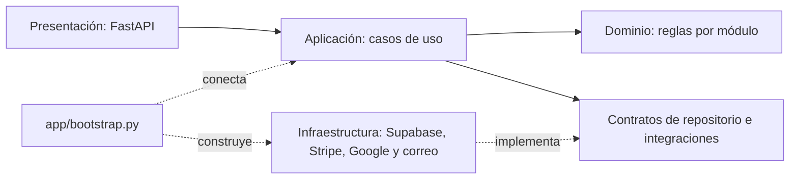
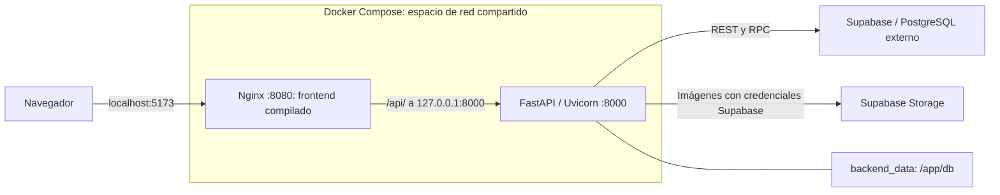

# Arquitectura de AC Silver's GYM

La aplicación combina Vue 3/Vite/Pinia, FastAPI/Pydantic y Supabase. Tanto el
frontend como el backend están contenerizados con Docker, cada uno con su propio
Dockerfile; Docker Compose construye sus imágenes y coordina los dos contenedores.
Su arquitectura incluye cuatro capas de código y los despliegues configurados
en Vercel y Render. Este documento describe los
archivos del repositorio; no certifica el estado de los servicios externos.

Las reglas y los contratos se separan de las implementaciones externas. Los
puntos de ensamblaje conectan repositorios, servicios y proveedores con los casos
de uso. Docker empaqueta los componentes para ejecución local y pruebas de CI;
la publicación configurada usa los runtimes propios de Vercel y Render.

## Componentes y formas de ejecución

| Componente | Implementación y ejecución |
| --- | --- |
| Web | Vue 3, Vue Router, Pinia y Vite; servidor Vite en desarrollo, Nginx en Docker o archivos estáticos en Vercel. |
| API | FastAPI, Pydantic y Uvicorn; Python local, contenedor Python 3.12 o servicio Python de Render. |
| Datos | Supabase/PostgreSQL externo al Compose; acceso REST y RPC desde el backend. |
| Imágenes | Supabase Storage con credenciales configuradas o adaptador de archivos locales. |
| Identidad y pagos | Sesiones firmadas, Google y Stripe, coordinados por el backend. |
| Correo | Resend y colas persistentes; procesador de membresías en backend y recordatorios en Supabase Edge Functions/Cron. |
| Automatización | GitHub Actions para validar PR, comprobar Docker y publicar tras merge a `main`. |

```text
backend/                     # API, capas, pruebas, migraciones y Dockerfile
frontend/                    # web, capas, pruebas, Dockerfile y Nginx/Vercel
supabase/                    # Edge Function, configuración y pruebas Deno
.github/workflows/           # validación de PR, documentación y CI/CD
.specify/                    # base de módulos, arquitectura, reglas, specs y skills
docker-compose.yml           # ejecución conjunta de API y Nginx
render.yaml                  # servicio Python del backend publicado
```

Los contratos funcionales están en [módulos](../base/modulos/README.md). La organización
Spec Driven se explica en [la guía de trabajo](../guias/spec-driven.md).

## Archivos `__init__.py`

Los archivos `__init__.py` identifican paquetes regulares de Python, como
`domain`, `application.services` o `infrastructure.repositories`. Python los
ejecuta al importar el paquete; pueden estar vacíos cuando no hay inicialización
que realizar. En este proyecto se mantienen vacíos de forma intencional para
evitar efectos secundarios y dependencias circulares durante los imports.

No son puntos de entrada del servidor ni necesitan importar todos los módulos
de su carpeta. El servidor arranca desde `app/main.py` y sus dependencias se
ensamblan en `app/bootstrap.py`. Python moderno también permite paquetes de espacio
de nombres sin `__init__.py`; aquí utilizamos paquetes regulares explícitos.

## Backend

| Capa | Ubicación | Responsabilidad |
| --- | --- | --- |
| Presentación | `backend/presentation/` | Rutas FastAPI, validación HTTP, permisos y traducción de errores. |
| Aplicación | `backend/application/` | Casos de uso, operaciones por módulo, contratos de repositorios, datos de lectura y coordinación de pagos y notificaciones. |
| Dominio | `backend/domain/` | Reglas de cuentas, membresías, promociones, asistencia, inventario, horarios y tienda, con sus modelos y contratos de contraseñas. |
| Infraestructura | `backend/infrastructure/` | Repositorios Supabase y memoria, transporte REST, seguridad, Stripe, Google, correo e imágenes. |

El ensamblaje está en `backend/app/bootstrap.py`. `app/main.py` conserva el punto
de entrada y `presentation/dependencies.py` conecta los servicios con FastAPI.
Las rutas obtienen sus adaptadores a través de este ensamblaje; las capas de
aplicación y dominio no importan infraestructura ni FastAPI.



### Reglas y persistencia

`GymDomainService` es un agregado en memoria compuesto por módulos de reglas:
`accounts_rules`, `memberships_rules`, `attendance_rules`, `inventory_rules`,
`schedules_rules`, `store_rules` y `dashboard_rules`. No lee archivos, guarda datos
ni consulta Supabase. Las contraseñas se procesan mediante `PasswordHasher`,
inyectado por la aplicación.

`GymService` coordina las operaciones de aplicación por módulo. El puerto recibe
comandos y consultas que declaran sus recursos mediante `Resource` y ejecutan
reglas a través de componentes explícitos. Las consultas y los resultados de comandos devuelven copias para evitar
que un consumidor modifique el estado persistido sin pasar por una operación.
Clientes y asistencia utilizan operaciones públicas y modelos de lectura en lugar
de acceder al estado, los bloqueos o los métodos privados de otro servicio.

`GymRepository` define las capacidades de lectura, cambio, refresco y operaciones
especializadas. `SupabaseGymRepository` y `MemoryGymRepository` implementan esas
capacidades mediante composición; no heredan del dominio.

Se conservan la caché y la detección diferencial de cambios. Las matrículas y
asistencias mantienen sus RPC específicas; una matrícula exige la RPC y nunca
recurre a un INSERT sin sus locks. Las demás mutaciones se confirman mediante
`commit_gym_transaction` (migración 015), incluyendo borrados y detalles de venta.
La RPC bloquea las tablas de los recursos declarados, comprueba que no cambiaron y confirma
todas las operaciones o ninguna. Ante un conflicto, el repositorio refresca y
recalcula las reglas, hasta tres intentos. No se usan compensaciones HTTP.

Los comandos de horarios y tienda declaran sus dependencias de lectura y escritura
por operación. Guardar una rutina necesita solamente el catálogo; matricular carga
clientes, membresías, catálogo, horarios de servicio y matrículas antes de ejecutar
su RPC. El resumen de asistencia usa conteos filtrados, visitas abiertas y ocho
entradas recientes; no materializa el historial cerrado. El historial conserva su
consulta paginada independiente.

`gym_identity_floors` combina los IDs actuales, las secuencias y una marca creciente
para evitar colisiones entre procesos y reutilización después de borrar. El código
visible del usuario se persiste en `codigo_usuario` y no cambia al modificar su rol.
La migración 016 concede a `service_role` los permisos sobre las secuencias que
necesitan esas RPC para consultar y avanzar identidades bajo `SECURITY INVOKER`.
Las RPC genéricas solo son ejecutables con `service_role`; no se exponen a usuarios
anónimos ni autenticados directamente. La migración 014 conserva los campos de
promociones, membresías, inventario y productos que ahora leen y escriben los mappers.

### Integraciones y compatibilidad

La verificación de Google, las sesiones firmadas, los pagos y los envíos de correo
se conectan mediante capacidades inyectadas. Los servicios de notificaciones
reciben explícitamente su repositorio de cola y su proveedor de envío; las
plantillas no dependen del transporte. El servicio de imágenes valida el archivo y
utiliza un adaptador de almacenamiento local o Supabase.

Los constructores históricos `SupabaseGymService` y `LocalGymService` se conservan
como fachadas de compatibilidad para consumidores y pruebas anteriores. Pueden
exponer los atributos internos antiguos, pero el ensamblaje de producción utiliza
`GymService` y los contratos públicos. No contienen una segunda implementación de
las reglas de negocio.

Los modelos Pydantic siguen siendo contratos de datos compartidos, no modelos ORM.
Las migraciones SQL y las pruebas permanecen en sus carpetas originales.
Sobre el esquema previo compatible y las RPC de matrícula/asistencia requeridas,
aplicar [014](../../backend/migrations/014_preserve_business_fields.sql), después
[015](../../backend/migrations/015_atomic_gym_transactions.sql) y finalmente
[016](../../backend/migrations/016_transaction_sequence_permissions.sql).
La última requiere ejecutarse como propietario de las secuencias. Las escrituras
actuales requieren `SUPABASE_SERVICE_ROLE_KEY` en el backend; la clave anónima
no puede ejecutar las RPC privadas. No ejecutar los archivos de rollback como
migraciones normales ni aplicar todos los SQL indiscriminadamente. La preparación
y comprobación de cambios SQL se define en el [DoD](DoD.md).

## Frontend

| Capa | Ubicación | Responsabilidad |
| --- | --- | --- |
| Presentación | `frontend/src/presentation/` | Pantallas, componentes, navegación, estilos y aplicación visual del tema. |
| Aplicación | `frontend/src/application/` | Estado de Pinia, operaciones por módulo, sesión, sincronización, pagos, catálogo y contratos de adaptadores. |
| Dominio | `frontend/src/domain/` | Cálculos, normalización y validaciones de clientes, membresías, pagos, asistencia y calendarios. |
| Infraestructura | `frontend/src/infrastructure/` | HTTP, SDK de Google, configuración del entorno, almacenamiento de sesión y preferencias del navegador. |

`frontend/src/bootstrap.js` instala los adaptadores explícitamente para una
instancia de Pinia antes de montar Vue. `application/ports/services.js` los asocia
con su propietario mediante un `WeakMap`, impide reinstalarlos y conserva una copia
inmutable de la configuración. Los servicios capturan sus adaptadores y la sesión
de esa instancia al construirse. Instalar otra aplicación no redirige consumidores
existentes. Las pruebas pueden inyectar capacidades sin realizar solicitudes reales.
Las vistas utilizan servicios de aplicación con operaciones de catálogo, pagos,
asistencia e imágenes.

`gymStore.js` conserva su nombre y su interfaz pública como fachada de Pinia.
Las operaciones están separadas en `application/modules/`: clientes, membresías,
asistencia, inventario, horarios, usuarios, tienda, panel y sincronización. Los
módulos reciben contextos acotados con las referencias y capacidades que necesitan,
ensamblados en `application/services/gymModules.js`. Al cambiar o cerrar sesión
se vacían los datos de negocio y las cachés. `sessionStore` aporta una generación
independiente de HTTP y autenticación; los adaptadores de aplicación rechazan
respuestas de una generación anterior antes de publicar datos.

Los módulos reciben repositorios con operaciones que
devuelven datos (`save`, `remove` y `load`). Su transporte HTTP está en
`infrastructure/repositories/` y se conecta en `bootstrap.js`; los módulos
ya no construyen solicitudes ni interpretan respuestas HTTP. Sincronización recibe
su gateway al ensamblarse. La actualización de
usuarios reutiliza una única función de normalización e inserción o reemplazo.

Se retiró la función vacía `persist()` y sus llamadas: los cambios remotos siguen
guardándose mediante las operaciones del backend que ya existían. Los cambios
locales mantienen sus referencias reactivas de Vue.

Las transformaciones comunes viven en `domain/utils/gymRules.js` y las validaciones
de autenticación en `domain/utils/authRules.js`. El almacenamiento de sesión vive
en `infrastructure/services/sessionStorage.js`. El módulo anterior `authUtils.js`
reexporta las funciones para conservar la compatibilidad.

Los módulos de aplicación usan el contrato del backend; los detalles de transporte
se conectan desde infraestructura. Las vistas y las reglas no ejecutan `fetch`
ni acceden a `localStorage`. Los cálculos de calendarios tampoco dependen de las
utilidades de presentación.

Las vistas de clientes y tienda delegan formularios, pagos de membresía y selección
de imágenes en composables de presentación. Sus diálogos tienen componentes
propios. El registro de asistencia por código resuelve al cliente y reutiliza la
misma operación de registro por ID.

`TrainerRoutineMonitorView` ensambla búsqueda, asignaciones, progreso y descanso
mediante composables con capacidades explícitas. La asignación directa y la del
diálogo reutilizan el mismo guardado. Las fichas de matrícula, el historial y los
diálogos son componentes separados; un solo temporizador alimenta sus dos
representaciones. Los borradores de ejercicios y las confirmaciones de
desvinculación tienen selección independiente.

`AttendanceView` coordina pestañas y compone resumen, búsqueda, visitas generales,
horarios y salidas pendientes. `useAttendanceControl` coordina mutaciones y
refrescos; `useAttendanceLookup` descarta búsquedas reemplazadas. Los componentes
reciben datos y emiten acciones; no acceden al transporte. Los estilos de control
se comparten bajo `.attendance-page` para conservar su alcance tras la extracción.

## Docker: imágenes, red y persistencia

### Construcción y usuarios de ejecución

El [Dockerfile del backend](../../backend/Dockerfile) utiliza `python:3.12-slim`.
La etapa `runtime` instala `requirements.txt` y copia `app`, `presentation`,
`application`, `domain` e `infrastructure`. Arranca con
`uvicorn app.main:app --host 0.0.0.0 --port 8000` como `appuser` (UID 10001).
El código queda legible sin permiso de escritura para ese usuario; se prepara
`/app/db/store-images` para archivos locales.

La etapa `test` añade dependencias de desarrollo, pruebas y migraciones, y
ejecuta flake8 y pytest. La etapa final `production` parte de `runtime`, por lo
que una construcción normal no incluye los archivos exclusivos de pruebas.

El [Dockerfile del frontend](../../frontend/Dockerfile) compila con `node:22-alpine`,
`npm ci` y `npm run build`. La etapa `test` reutiliza la construcción y ejecuta
`npm test`. La imagen final usa `nginx:1.27-alpine`, recibe `dist` y su configuración,
y ejecuta Nginx como usuario `nginx` en el puerto 8080. Node y las pruebas no
forman parte de esa imagen final.

Los `.dockerignore` excluyen archivos de entorno, dependencias locales y otros
artefactos del contexto de construcción. Los valores `VITE_*` se incorporan al
JavaScript al compilar: son configuración pública. Cambiarlos en Docker requiere
reconstruir el frontend; las claves privadas se inyectan solo en el backend.

### Topología de Compose

[docker-compose.yml](../../docker-compose.yml) define dos servicios. `backend`
usa `network_mode: bridge`; `frontend` usa `network_mode: service:backend` y
comparte su espacio de red. Nginx conecta a la API mediante `127.0.0.1:8000`,
sin resolver un nombre de servicio.

| Acceso desde el equipo | Destino dentro de Docker | Uso |
| --- | --- | --- |
| `http://localhost:5173` | Nginx, puerto 8080 | Interfaz web y proxy `/api/`. |
| `http://localhost:8000` | Uvicorn, puerto 8000 | API directa, `/health` y documentación `/docs`. |

Ambos puertos se publican en el servicio `backend`. `frontend` espera a que el
backend esté saludable. Los dos tienen `restart: unless-stopped`; Compose
también declara reinicio del frontend cuando se actualiza su dependencia.



El volumen `backend_data` conserva `/app/db`, incluida la ruta de imágenes
locales. Los datos de negocio siguen en Supabase: ese volumen no es una copia
de PostgreSQL. Compose no levanta una base ni aplica migraciones. Tampoco monta
el código fuente; los cambios requieren reconstruir las imágenes.

### Nginx y comprobaciones de salud

[nginx.conf](../../frontend/nginx.conf) sirve la SPA con fallback a `index.html`
y reenvía `/api/` al backend, conservando el prefijo. `index.html` usa `no-store`;
los recursos de `/assets/` con hash se cachean un año como inmutables. La
[configuración principal](../../frontend/nginx-main.conf) y las rutas temporales
usan `/tmp` para la ejecución sin root. Los logs salen por stdout/stderr.

La sonda normal del backend consulta `/health`, que lee el catálogo de planes
para comprobar acceso a Supabase. La del frontend comprueba la web y `/api/health`
a través de Nginx. `GET /` del backend solo indica que el proceso HTTP responde.
Sin credenciales válidas, `/health` o `/api/health` puede devolver 503.

En CI, `DOCKER_CHECK_DATABASE=false` cambia las sondas a comprobaciones de arranque
sin Supabase. El workflow comprueba después que el 503 de `/api/health` es idéntico
por acceso directo y proxy. Esto valida arranque y encaminamiento, sin acreditar
una integración real con la base o los proveedores.

## Configuración de entorno y servicios externos

| Ubicación | Uso |
| --- | --- |
| `.env` de la raíz | Interpolación de Docker Compose: argumentos públicos de compilación y opciones de ejecución. |
| `backend/.env` | Configuración de servidor; Compose la inyecta con `env_file`. `BACKEND_ENV_FILE` permite sustituir la ruta, como hace CI. |
| `frontend/.env` | Variables Vite para desarrollo manual o compilación local desde `frontend/`. |
| Vercel / Render | Variables propias del servicio publicado; independientes de los archivos del equipo. |
| Supabase Secrets / Vault | Configuración de la Edge Function y secreto compartido con Cron. |

[config.py](../../backend/infrastructure/config.py) prioriza el entorno del proceso.
Para ejecución manual carga `backend/.env` y después `.env` de la raíz sin
sobrescribir valores ya definidos. En Docker las credenciales se inyectan al
arrancar, sin copiarlas a la imagen.

| Función | Variables relevantes |
| --- | --- |
| Datos y sesión | `SUPABASE_URL`, `SUPABASE_SERVICE_ROLE_KEY`, `AUTH_SECRET_KEY` (mínimo 32 bytes). |
| Conexión del navegador | `VITE_AUTH_API_BASE_URL`, `VITE_SUPABASE_URL`, `VITE_SUPABASE_ANON_KEY`. |
| Orígenes y retornos | `CORS_ORIGINS`, `FRONTEND_PUBLIC_URL`. |
| Google | `GOOGLE_CLIENT_ID` en backend y `VITE_GOOGLE_CLIENT_ID` en frontend. |
| Stripe | `STRIPE_SECRET_KEY`, `STRIPE_WEBHOOK_SECRET`, `STRIPE_MODE`. |
| Imágenes | `STORE_IMAGES_DIR`, `SUPABASE_STORE_IMAGES_BUCKET` y configuración pública de buckets/rutas en frontend. |
| Correo | `RESEND_API_KEY`, `EMAIL_FROM`, `EMAIL_FROM_NAME`. |

El ensamblaje selecciona `SupabaseStorageService` cuando hay credenciales Supabase
y `LocalImageStorage` en caso contrario. El backend conserva la ruta pública
`/api/uploads/store-images` para archivos locales. La landing puede leer imágenes
públicas directamente desde Supabase Storage.

Las notificaciones de membresía se procesan en segundo plano durante el ciclo
de vida del backend. Los recordatorios de clases usan
[schedule-emails](../../supabase/functions/schedule-emails/index.ts), desplegada
aparte en Supabase. [supabase/config.toml](../../supabase/config.toml) desactiva
la validación del JWT de usuario para esa función; su handler valida un secreto
propio de Cron. La migración
[007_schedule_emails_cron.sql](../../backend/migrations/007_schedule_emails_cron.sql)
registra el trabajo cada minuto y lo deja pausado para verificar su configuración
antes de activarlo. Tener el SQL y la función en Git no los despliega ni activa.

## Desarrollo, publicación y CI/CD

En desarrollo manual, Vite escucha normalmente en 5173 y su proxy `/api` apunta
a `http://localhost:8000`, configurable con `VITE_BACKEND_URL` en
[vite.config.js](../../frontend/vite.config.js). Uvicorn arranca desde `backend/`.
Este modo no utiliza Nginx ni requiere construir imágenes.

La configuración publicada separa los servicios:

- **Vercel:** compila `frontend/` y sirve `dist` según
  [vercel.json](../../frontend/vercel.json). Sus rewrites resuelven rutas de la
  SPA y no configuran un proxy `/api` a Render. `VITE_AUTH_API_BASE_URL` debe
  apuntar a la URL pública del backend terminada en `/api`.
- **Render:** [render.yaml](../../render.yaml) define un servicio `runtime: python`,
  instala `requirements.txt` y arranca Uvicorn usando `$PORT`. Su sonda consulta
  `/health`. Configurar `CORS_ORIGINS` con el origen publicado del frontend y
  `FRONTEND_PUBLIC_URL` para enlaces de retorno y notificaciones.
- **Supabase:** aloja la base, Storage y la función/Cron configurados aparte.
  Las migraciones SQL se aplican según sus dependencias; Docker y los workflows
  actuales no las ejecutan sobre producción.

Los Dockerfiles se usan en Compose y CI. El pipeline actual no publica imágenes
en un registro ni despliega esos contenedores en Vercel o Render.

| Workflow | Disparador | Comprobaciones y resultado |
| --- | --- | --- |
| [pr-validation.yml](../../.github/workflows/pr-validation.yml) | PR a `develop` o `main`. | Targets Docker `test`, compilación frontend, Deno y PostgreSQL 16 desechable para contratos/concurrencia. |
| [spec-docs.yml](../../.github/workflows/spec-docs.yml) | PR a `develop` o `main`; ejecución manual. | Validación de contexto/documentación y pruebas aisladas de Spec Driven. |
| [ci-cd.yml](../../.github/workflows/ci-cd.yml) | PR fusionado a `main`. | Construcción/arranque/proxy con Compose, tests backend/frontend/Deno y despliegue condicionado al éxito. |

Los targets `test` se ejecutan con `--network none` y sin credenciales de
producción. PostgreSQL real se valida en el job específico de PR; no forma parte
del Compose de aplicación ni se repite como job independiente en el pipeline de
merge. Cerrar un PR sin fusionarlo no ejecuta el pipeline de publicación.

Tras las pruebas de merge, Vercel recupera variables de producción, compila y
publica el resultado con su CLI. Render recibe un Deploy Hook con el mismo commit.
Los secretos de Actions son `VERCEL_TOKEN`, `VERCEL_ORG_ID`, `VERCEL_PROJECT_ID`
y `RENDER_DEPLOY_HOOK_URL`. Aceptar el hook no acredita que Render haya terminado
de publicar. Se mantienen desactivados los despliegues automáticos por Git para
que el pipeline controle la publicación.

## Límites actuales de la separación

La organización y las dependencias principales siguen las cuatro capas, pero
todavía existen decisiones que limitan su independencia:

- `GymService` y `gymStore` siguen siendo fachadas centrales de varios módulos.
  El dominio conserva un estado compartido internamente y métodos antiguos de
  compatibilidad; los registros de negocio siguen siendo diccionarios.
- La transacción general compara instantáneas completas de cada recurso elegido
  y bloquea tablas. Acotar los recursos reduce conflictos ajenos, pero no aporta
  concurrencia por fila ni elimina el coste de cargar una tabla seleccionada.
- Clientes, membresías y pedidos todavía tienen consultas que devuelven listas
  completas. La paginación de asistencia y su resumen especializado no equivalen
  a paginación uniforme de toda la API.
- Los módulos del frontend conservan coordinación explícita detrás de una fachada
  de Pinia. Las vistas de clientes y tienda son más pequeñas, pero aún reúnen
  listados, filtros y acciones; otras pantallas extensas requieren revisión propia.

Las pruebas de imports comprueban dependencias entre capas; por sí solas no
demuestran que todas las responsabilidades estén completamente separadas.

## Compatibilidad y verificación

Se mantienen los endpoints, los esquemas públicos de la API, las pantallas, las
claves de sesión, los nombres de variables de entorno y las rutas públicas de
imágenes. La ubicación predeterminada de las imágenes sigue siendo
`backend/db/store-images` y `/app/db/store-images` dentro de Docker.

Además de las pruebas funcionales existentes, las pruebas de arquitectura
comprueban las direcciones de importación, la sustitución de proveedores y la
ausencia de herencia entre persistencia y dominio. Se verifican también la
protección de los datos devueltos, los errores de persistencia, la liberación de
stock pendiente y la validación y publicación de imágenes.

Los comandos de desarrollo conservan su forma:

```bash
cd backend
python -m app.main
```

```bash
cd frontend
npm run dev
```

Para verificar los cambios:

```bash
cd backend
python -m pytest tests/ -q
python -m flake8 . --count --select=E9,F63,F7,F82 --show-source --statistics
```

```bash
cd frontend
npm test
npm run build
```

Los Dockerfiles incluyen los cuatro paquetes y los módulos nuevos. Los targets
`test` permiten ejecutar las mismas comprobaciones sin credenciales de producción.
