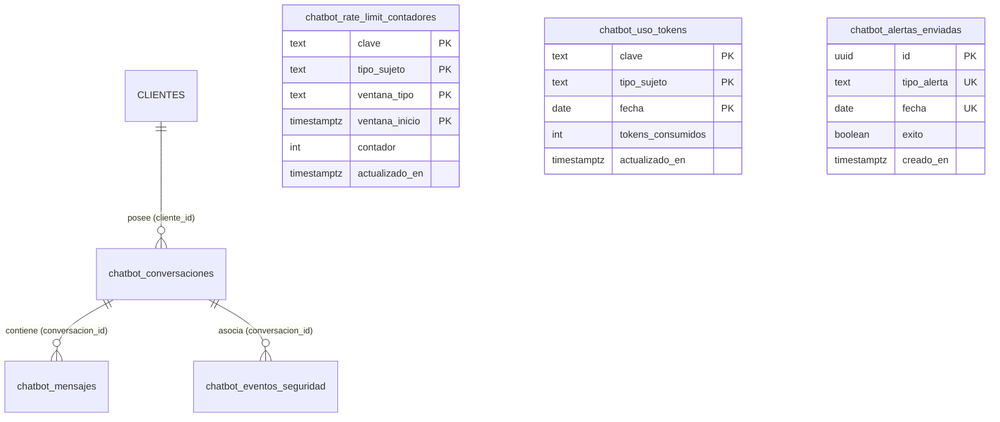

# Modelo de Datos: Reglas de Control del Chatbot

**Feature:** `002-chatbot-reglas-control` · **Fecha:** 2026-11-08  
**Implementación DDL:** [01_crear_tablas.sql](sql/01_crear_tablas.sql) · **Validación:** [02_validar_tablas.sql](sql/02_validar_tablas.sql)  
**Propuesta de Seguridad:** [03_rls_propuesta.sql](sql/03_rls_propuesta.sql)  

---

## 1. Diagrama Entidad-Relación

---

## 2. Inventario de Tablas y Restricciones

### 2.1 `chatbot_conversaciones`
Registra el ciclo de vida de cada sesión, control de inactividad (30 min) y acciones pendientes de confirmación (5 min).
- **PK:** `id UUID DEFAULT gen_random_uuid()`
- **FK:** `cliente_id BIGINT NULL REFERENCES public."CLIENTES"(id_cliente) ON DELETE SET NULL`
- **Campos:** `tipo_sujeto` (`CHECK IN ('visitante', 'cliente')`), `sesion_navegador_id TEXT`, `ip_hmac TEXT`, `estado` (`CHECK IN ('activa', 'cerrada', 'expirada_inactividad')`), `ultimo_mensaje_en TIMESTAMPTZ`, `accion_pendiente JSONB`, `accion_pendiente_desde TIMESTAMPTZ`, `creado_en TIMESTAMPTZ`, `cerrado_en TIMESTAMPTZ`.

### 2.2 `chatbot_mensajes`
Historial de mensajes sin datos sensibles en texto plano.
- **PK:** `id UUID DEFAULT gen_random_uuid()`
- **FK:** `conversacion_id UUID NOT NULL REFERENCES chatbot_conversaciones(id) ON DELETE CASCADE`
- **Campos:** `rol` (`CHECK IN ('usuario', 'asistente', 'sistema')`), `contenido TEXT NOT NULL` (sanitizado), `tokens_consumidos INTEGER NULL CHECK >= 0`, `accion_detectada TEXT NULL`, `creado_en TIMESTAMPTZ NOT NULL`.

### 2.3 `chatbot_rate_limit_contadores`
Contadores de rate limiting para ventanas de minuto y día.
- **PK Compuesta:** `(clave, tipo_sujeto, ventana_tipo, ventana_inicio)`
- **Campos:** `clave TEXT`, `tipo_sujeto` (`'cliente'`, `'visitante'`), `ventana_tipo` (`'minuto'`, `'dia'`), `ventana_inicio TIMESTAMPTZ`, `contador INTEGER CHECK >= 0`, `actualizado_en TIMESTAMPTZ`.

### 2.4 `chatbot_uso_tokens`
Acumulador diario de tokens por usuario y a nivel global de la organización.
- **PK Compuesta:** `(clave, tipo_sujeto, fecha)`
- **Campos:** `clave TEXT` (`id_cliente`, `ip_hmac` o `'__sistema__'`), `tipo_sujeto` (`'cliente'`, `'visitante'`, `'global'`), `fecha DATE`, `tokens_consumidos INTEGER CHECK >= 0`, `actualizado_en TIMESTAMPTZ`.

### 2.5 `chatbot_eventos_seguridad`
Pista de auditoría de anomalías, abusos e intentos de acceso no autorizados.
- **PK:** `id UUID DEFAULT gen_random_uuid()`
- **FK:** `conversacion_id UUID NULL REFERENCES chatbot_conversaciones(id) ON DELETE SET NULL`
- **Campos:** `cliente_id BIGINT NULL`, `tipo_sujeto TEXT NULL`, `ip_hmac TEXT NULL`, `tipo_evento TEXT NOT NULL CHECK IN ('acceso_datos_tercero', 'jwt_invalido', 'jwt_expirado', 'accion_no_permitida', 'datos_sensibles_entrada', 'limite_mensajes_superado', 'limite_tokens_superado')`, `detalle JSONB NULL` (sin PII ni datos ajenos), `creado_en TIMESTAMPTZ NOT NULL`.

### 2.6 `chatbot_alertas_enviadas`
Deduplicación de notificaciones de presupuesto enviadas por Resend.
- **PK:** `id UUID DEFAULT gen_random_uuid()`
- **Restricción UNIQUE:** `(tipo_alerta, fecha)`
- **Campos:** `tipo_alerta TEXT NOT NULL CHECK IN ('umbral_80', 'tope_100')`, `fecha DATE NOT NULL`, `exito BOOLEAN NOT NULL`, `creado_en TIMESTAMPTZ NOT NULL`.

---

## 3. Garantías de Privacidad y Seguridad en Datos

1. **Anonimización de IPs (Ley 29733):** Toda IP se transforma mediante `HMAC-SHA256(ip_real, CHATBOT_IP_HMAC_SECRET)` antes de guardarse en base de datos. Es imposible recuperar la IP original desde la base de datos si la clave no está comprometida.
2. **Cero PII en Historial (RN-07, RN-08):** DNI, contraseñas, teléfonos y correos son enmascarados o filtrados en la memoria del backend antes de emitir la sentencia `INSERT INTO chatbot_mensajes`.
3. **Aislamiento Multi-inquilino/Usuario:** Las consultas de datos personales se encuentran estrictamente filtradas por `cliente_id = :id_jwt`. No existen endpoints donde el usuario pueda pasar un `id_cliente` arbitrario.
