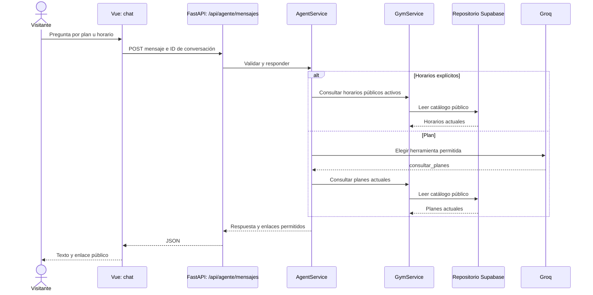

# Batería de pruebas del agente v1

**Rama de trabajo:** `levano/agenteAgente.v1-pruebas`, creada desde `levano/agenteAgente.v1` (`55f6ec5`). **Fecha:** 2026-11-13. Esta batería acompaña los [criterios de aceptación](spec.md) y conserva la versión v1 ya publicada como línea base.

## Plan y recorrido

El flujo de negocio elegido es **visitante → consulta pública → decisión de registro**. Se agrupan casos pequeños para comprobar primero cada parte y luego el recorrido desde la pantalla. El segundo flujo es **visitante → recuperación de cuenta → protección de datos**. La regresión reúne ambos flujos con las pruebas existentes; la cantidad de pruebas responde a los criterios y riesgos, no a una cifra fija.



El proveedor de IA **elige una herramienta** cuando hace falta; el backend valida la elección y consulta la fuente. La IA no accede directamente a Supabase. Para recuperación, el backend solo indica abrir el formulario local; el navegador no envía correo, DNI ni teléfono al endpoint.

## Matriz de casos agrupados

| Flujo / caso | Criterio | Capa y herramienta | Datos y pasos | Resultado esperado | Prioridad | Evidencia |
| --- | --- | --- | --- | --- | --- | --- |
| F1-01 Plan | CA-01, CA-02, CA-08 | Vue → API → servicio → catálogo controlado; Playwright | Abrir chat y preguntar precio de un plan de prueba. | El texto refleja S/ 91 y 31 días del catálogo controlado; ofrece Registro; HTTP 200. | Alta | `frontend/e2e-integration/agent-flow.spec.js` |
| F1-02 Horario | CA-01, CA-02, CA-08 | Vue → API → servicio → catálogo controlado; Playwright | En la misma conversación, preguntar horario de Baile. | Muestra lunes 07:00–08:00, valor leído del catálogo controlado; HTTP 200. | Alta | `frontend/e2e-integration/agent-flow.spec.js` |
| F1-03 Fuente actual | CA-01, CA-02 | Vue → API → servicio → repositorio → Supabase; Playwright de solo lectura | Leer horarios públicos y pedir todos los horarios en el chat. | Al menos un horario real y su actividad aparecen en la respuesta; no hay escrituras. | Alta | `frontend/e2e-live/agent-catalog.spec.js` |
| F2-01 Recuperación | CA-03, CA-05, CA-08 | Vue → API → servicio; Playwright | Pedir recuperación y completar correo, DNI y teléfono sintéticos. | Se abre el formulario; solo sale a la API la pregunta inicial; no sale ningún dato del formulario. | Alta | `frontend/e2e-integration/agent-flow.spec.js` |
| R-01 Regresión UI | CA-01, CA-03, CA-04, CA-05, CA-08, CA-09 | Interfaz; Playwright con API simulada | Planes, clases, lista larga, caída, límite, acción privada, recuperación y PII. | Los nueve escenarios pasan en Chromium, Firefox y WebKit. | Alta | `frontend/e2e/agent.spec.js` |
| R-02 Regresión backend | CA-01 a CA-09 | Servicio, dominio y ruta; pytest | Datos sintéticos y proveedor falso. | Casos de permisos, catálogos, conversación y HTTP pasan sin servicios externos. | Alta | `backend/tests/agente/` |

Los casos F1-01/02 forman un flujo compartido: la misma persona pregunta por un plan y luego por horarios, con el mismo chat. El test usa un proceso FastAPI real y el proxy de Vite; sustituye únicamente el proveedor y el catálogo. F1-03 comprueba por separado la lectura del catálogo real de Supabase a través de la API pública. No prueba escrituras, pagos ni correos.

## Antes y después

| Momento | Referencia | Resultado |
| --- | --- | --- |
| Antes de añadir casos | v1 `55f6ec5` | Backend: 100 aprobadas; frontend: 373 aprobadas; Playwright UI: 27 aprobadas; compilación aprobada. |
| Después de añadir casos | `levano/agenteAgente.v1-pruebas` | Backend: 100 aprobadas; frontend: 373 aprobadas; Playwright UI: 27 aprobadas; Playwright integrado: 6 aprobadas (2 casos × 3 motores); Playwright con Supabase público: 1 aprobada en Chromium; compilación aprobada; flake8 crítico: 0 errores. |

En la primera ejecución de F1-03 falló la comparación literal de «Musculación»: el catálogo usa otra acentuación que la respuesta presentada. Se corrigió la aserción para comparar el nombre normalizado; el horario y la respuesta del producto ya coincidían. No se modificó código productivo.

## Repetición y límites

Desde `frontend`:

```powershell
npx playwright test e2e/agent.spec.js
npx playwright test --config=playwright.agent-integration.config.js
npx playwright test --config=playwright.agent-live.config.js
npx playwright show-report playwright-agent-integration-report
npx playwright show-report playwright-agent-live-report
```

Desde `backend`:

```powershell
.venv\Scripts\python.exe -B -m pytest tests/agente tests/planes_promociones tests/horarios_matriculas/integracion -q -p no:cacheprovider --tb=short
```

El caso **live** requiere los `.env` locales ya existentes y acceso a Supabase; es voluntario y ejecuta únicamente la app `app.agent_readonly_app`, que publica el chat y tres GET públicos. La prueba pregunta por horarios y no llama a Groq. Los demás casos no requieren claves ni servicios externos. Ningún `.env`, dato real de cliente ni reporte generado se añade a Git. El Quality Gate de SonarQube se presenta por separado cuando el servidor y el scanner del proyecto estén disponibles; esta batería no atribuye cobertura nueva a Sonar.

Las coberturas Sonar QA conocidas antes de esta rama eran **backend 71,6 %** y **frontend 73,6 %**. Son una referencia histórica del proyecto, no una medición nueva del agente. Los reportes HTML locales de Playwright se generan al ejecutar los comandos sin cambiar el reporter; se mantienen fuera de Git. Para enseñar la prueba al profesor, abrir la matriz, el archivo del caso y luego el reporte correspondiente.

La validación documental general (`python .specify/.codex/hooks/validate.py`) sigue informando 11 skills no descubribles ya señaladas en la validación de v1. No apareció un error documental nuevo en los archivos de esta batería.
