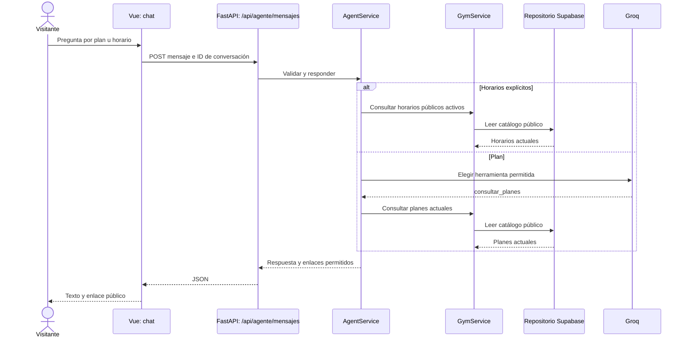

# Batería de pruebas del agente v1

**Rama de trabajo:** `levano/agenteAgente.v1-pruebas`, creada desde `levano/agenteAgente.v1` (`55f6ec5`). **Ejecuciones:** 2026-11-13; **trazabilidad revisada:** 2026-11-19. Esta batería acompaña los [criterios de aceptación](spec.md) y conserva la versión v1 ya publicada como línea base. La revisión documental no constituye una nueva ejecución de pruebas.

## Plan y recorrido

El flujo de negocio elegido es **visitante → consulta pública → decisión de registro**. Se agrupan casos pequeños para comprobar primero cada parte y luego el recorrido desde la pantalla. El segundo flujo es **visitante → recuperación de cuenta → protección de datos**. La regresión reúne ambos flujos con las pruebas existentes; la cantidad de pruebas responde a los criterios y riesgos, no a una cifra fija.



El proveedor de IA **elige una herramienta** cuando hace falta; el backend valida la elección y consulta la fuente. La IA no accede directamente a Supabase. Para recuperación, el backend solo indica abrir el formulario local; el navegador no envía correo, DNI ni teléfono al endpoint.

## Matriz de casos agrupados

| Flujo / caso | Criterio | Capa y herramienta | Datos y pasos | Resultado esperado | Prioridad | Evidencia |
| --- | --- | --- | --- | --- | --- | --- |
| F1-01 Plan | CA-01, CA-08 | Vue → API → servicio → catálogo controlado; Playwright | Abrir chat y preguntar precio de un plan de prueba. | El texto refleja S/ 91 y 31 días del catálogo controlado; ofrece Registro; HTTP 200. | Alta | `frontend/tests/e2e/integracion/agent-flow.spec.js` |
| F1-02 Horario | CA-02, CA-08 | Vue → API → servicio → catálogo controlado; Playwright | En la misma conversación, preguntar horario de Baile. | Muestra lunes 07:00–08:00, valor leído del catálogo controlado; HTTP 200. | Alta | `frontend/tests/e2e/integracion/agent-flow.spec.js` |
| F1-03 Fuente actual | CA-02 | Vue → API → servicio → repositorio → Supabase; Playwright de solo lectura | Leer horarios públicos y pedir todos los horarios en el chat. | Al menos un horario real y su actividad aparecen en la respuesta; no hay escrituras. | Alta | `frontend/tests/e2e/catalogo/agent-catalog.spec.js` |
| F2-01 Recuperación | CA-05, CA-08, CA-11 | Vue → API → servicio; Playwright | Pedir recuperación y completar correo, DNI y teléfono sintéticos. | Se abre el formulario; solo sale a la API la pregunta inicial; no sale ningún dato del formulario. | Alta | `frontend/tests/e2e/integracion/agent-flow.spec.js` |
| R-01 Regresión UI | CA-01, CA-02, CA-03, CA-04, CA-05, CA-08, CA-09, CA-11, CA-13 | Interfaz; Playwright con API simulada | Planes, clases, lista larga, caída, límite, acción privada, recuperación y PII. | Los nueve escenarios pasan en Chromium, Firefox y WebKit. | Alta | `frontend/tests/e2e/simuladas/agent.spec.js` |
| R-02 Regresión backend | CA-01, CA-02, CA-03, CA-04, CA-05, CA-06, CA-07, CA-08, CA-09, CA-10, CA-11, CA-12, CA-13 (componente backend) | Servicio, dominio y ruta; pytest | Datos sintéticos y proveedor falso. | Casos de permisos, catálogos, conversación y HTTP pasan sin servicios externos. La privacidad del formulario se comprueba en F2-01/R-01. | Alta | `backend/tests/agente/` |

Los casos F1-01/02 forman un flujo compartido: la misma persona pregunta por un plan y luego por horarios, con el mismo chat. El test usa un proceso FastAPI real y el proxy de Vite; sustituye únicamente el proveedor y el catálogo. F1-03 comprueba por separado la lectura del catálogo real de Supabase a través de la API pública. No prueba escrituras, pagos ni correos.

## Conversaciones encadenadas · ampliación del 2026-11-19

Cada fila representa un recorrido completo: se conserva el identificador de la conversación y se comprueba lo que ocurre después de cada mensaje. Los datos de catálogo y la selección del proveedor se controlan en las pruebas; se ejecutan el servicio y la ruta reales. El objetivo es comprobar las promesas de la v1, sin convertir cada pregunta imaginable en un caso nuevo.

| Caso | Criterios | Mensajes del visitante, en orden | Resultado esperado y fuente | Riesgo / prioridad | Ejecución |
| --- | --- | --- | --- | --- | --- |
| CONV-01 · Elegir cómo empezar | CA-01, CA-02, CA-03, CA-10, CA-12 | «Hola» → «¿Cuánto cuesta el plan?» → «¿Qué horarios tiene Baile?» → «¿Cómo me registro?» → «Inscríbeme a Baile» → «Gracias». | Cortesía; precio y horario del catálogo controlado; guía y enlace a Registro; la orden de inscripción no crea matrícula; cierre natural. Solo la consulta de plan necesita seleccionar herramienta. | Datos inventados o una operación privada ejecutada · alta | `backend/tests/agente/test_agent_conversations.py`; `frontend/tests/e2e/integracion/agent-conversations.spec.js` |
| CONV-02 · Actividad y seguimiento | CA-02, CA-03, CA-09 | «¿Qué tipos de ejercicios hay?» → «¿Y los horarios?» → «¿Hay cupo en Baile el lunes?» | Ficha pública de actividades; el seguimiento consulta horarios actuales; la respuesta sobre cupos solo comunica la regla general y no afirma disponibilidad ni reserva. | Confundir horario publicado con cupo libre · alta | Los mismos archivos |
| CONV-03 · Recuperar sin exponer datos | CA-05, CA-11 | «Quiero recuperar mi cuenta» → completar el formulario con datos sintéticos → escribir un correo en el chat. | Formulario local; el backend solo recibe la pregunta inicial; el correo escrito en el chat se bloquea antes de la API. No se promete envío al dueño. | Filtración de datos personales · alta | Los mismos archivos y la regresión UI existente |
| CONV-04 · Volver al negocio | CA-07, CA-10 | Pregunta ambigua → pregunta ajena → repetir pregunta ajena → preguntar por un plan. | Pedir detalle; redirigir con cortesía y después con mayor claridad; volver a consultar el catálogo sin perder el control del diálogo. | Respuestas genéricas repetidas o tema ajeno persistente · media | Los mismos archivos |

**Decisión pendiente, fuera de v1:** «¿Está lleno el horario de Baile del lunes?» exige consultar cupos actuales y distinguir clases sin espacio. El agente de esta rama solo lee horarios publicados y una ficha general sobre cupos; esta batería comprueba que no afirme «hay espacio» ni «está lleno» sin ese dato. Añadir disponibilidad o reserva requiere un criterio nuevo del SPEC, contrato de lectura y pruebas propios.

## Antes y después

| Momento | Referencia | Resultado |
| --- | --- | --- |
| Antes de añadir casos | v1 `55f6ec5` | Backend: 100 aprobadas; frontend: 373 aprobadas; Playwright UI: 27 aprobadas; compilación aprobada. |
| Después de añadir casos | `levano/agenteAgente.v1-pruebas` | Backend: 100 aprobadas; frontend: 373 aprobadas; Playwright UI: 27 aprobadas; Playwright integrado: 6 aprobadas (2 casos × 3 motores); Playwright con Supabase público: 1 aprobada en Chromium; compilación aprobada; flake8 crítico: 0 errores. |

En la primera ejecución de F1-03 falló la comparación literal de «Musculación»: el catálogo usa otra acentuación que la respuesta presentada. Se corrigió la aserción para comparar el nombre normalizado; el horario y la respuesta del producto ya coincidían. No se modificó código productivo.

### Ampliación conversacional del 2026-11-19

| Momento | Batería ejecutada | Resultado |
| --- | --- | --- |
| Antes de CONV-01 a CONV-04 | `pytest tests/agente tests/planes_promociones tests/horarios_matriculas/integracion`; `npm test`; Playwright UI; Playwright integrado | Backend 100/100, frontend 373/373, UI 27/27 e integración 6/6. |
| Después de añadir los recorridos | Los mismos comandos, con cuatro casos de servicio y cuatro casos integrados nuevos (estos últimos en Chromium, Firefox y WebKit) | Backend 104/104, frontend 373/373, UI 27/27 e integración 18/18. `flake8` crítico: 0 errores. |

Los 12 resultados nuevos de Playwright corresponden a **cuatro flujos completos × tres motores**, no a 12 flujos distintos. El servidor de QA usa catálogo y proveedor controlados, sin llamadas externas; su límite de mensajes se amplía solo en ese proceso para que los tres motores no compartan una cuota agotada. El límite de producto se comprueba en las pruebas de backend. El caso de Supabase en vivo no se volvió a ejecutar en esta ampliación. No se modificó el código productivo.

## Repetición y límites

Desde `frontend`:

```powershell
npm run test:e2e
npm run test:e2e:integracion
npm run test:e2e:catalogo
npx playwright show-report .artifacts/playwright/integracion/informe
npx playwright show-report .artifacts/playwright/catalogo/informe
```

Desde `backend`:

```powershell
.venv\Scripts\python.exe -B -m pytest tests/agente tests/planes_promociones tests/horarios_matriculas/integracion -q -p no:cacheprovider --tb=short
```

El caso **live** requiere los `.env` locales ya existentes y acceso a Supabase; es voluntario y ejecuta únicamente la app `app.agent_readonly_app`, que publica el chat y tres GET públicos. La prueba pregunta por horarios y no llama a Groq. Los demás casos no requieren claves ni servicios externos. Ningún `.env`, dato real de cliente ni reporte generado se añade a Git. El Quality Gate de SonarQube se presenta por separado cuando el servidor y el scanner del proyecto estén disponibles; esta batería no atribuye cobertura nueva a Sonar.

Las coberturas Sonar QA conocidas antes de esta rama eran **backend 71,6 %** y **frontend 73,6 %**. Son una referencia histórica del proyecto, no una medición nueva del agente. Los reportes HTML locales de Playwright se generan al ejecutar los comandos sin cambiar el reporter; se mantienen fuera de Git. Para enseñar la prueba al profesor, abrir la matriz, el archivo del caso y luego el reporte correspondiente.

La validación documental general (`python .specify/.codex/hooks/validate.py`) sigue informando 11 skills no descubribles ya señaladas en la validación de v1. No apareció un error documental nuevo en los archivos de esta batería.
