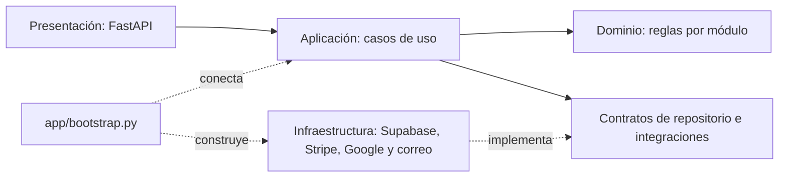

# Arquitectura de AC Silver's GYM

El backend y el frontend se organizan en cuatro capas. Las reglas y los contratos
no importan implementaciones externas. Los puntos de ensamblaje conectan las
implementaciones con los servicios que las utilizan.

## Archivos `__init__.py`

Los archivos `__init__.py` identifican paquetes regulares de Python, como
`domain`, `application.services` o `infrastructure.repositories`. Python los
ejecuta al importar el paquete; pueden estar vacíos cuando no hay inicialización
que realizar. En este proyecto se mantienen vacíos de forma intencional para
evitar efectos secundarios y dependencias circulares durante los imports.

No son puntos de entrada del servidor ni necesitan importar todos los módulos
de su carpeta. El servidor arranca desde `app/main.py` y sus dependencias se
ensamblan en `app/bootstrap.py`. Python moderno también permite paquetes de espacio
de nombres sin `__init__.py`; aquí utilizamos paquetes regulares explícitos.

## Backend

| Capa | Ubicación | Responsabilidad |
| --- | --- | --- |
| Presentación | `backend/presentation/` | Rutas FastAPI, validación HTTP, permisos y traducción de errores. |
| Aplicación | `backend/application/` | Casos de uso, operaciones por módulo, contratos de repositorios, datos de lectura y coordinación de pagos y notificaciones. |
| Dominio | `backend/domain/` | Reglas de cuentas, membresías, promociones, asistencia, inventario, horarios y tienda, con sus modelos y contratos de contraseñas. |
| Infraestructura | `backend/infrastructure/` | Repositorios Supabase y memoria, transporte REST, seguridad, Stripe, Google, correo e imágenes. |

El ensamblaje está en `backend/app/bootstrap.py`. `app/main.py` conserva el punto
de entrada y `presentation/dependencies.py` conecta los servicios con FastAPI.
Las rutas obtienen sus adaptadores a través de este ensamblaje; las capas de
aplicación y dominio no importan infraestructura ni FastAPI.



### Reglas y persistencia

`GymDomainService` es un agregado en memoria compuesto por módulos de reglas:
`accounts_rules`, `memberships_rules`, `attendance_rules`, `inventory_rules`,
`schedules_rules`, `store_rules` y `dashboard_rules`. No lee archivos, guarda datos
ni consulta Supabase. Las contraseñas se procesan mediante `PasswordHasher`,
inyectado por la aplicación.

`GymService` coordina las operaciones de aplicación por módulo. Consulta el
repositorio o ejecuta una unidad de trabajo que aplica las reglas sobre los datos
cargados. Las consultas y los resultados de comandos devuelven copias para evitar
que un consumidor modifique el estado persistido sin pasar por una operación.
Clientes y asistencia utilizan operaciones públicas y modelos de lectura en lugar
de acceder al estado, los bloqueos o los métodos privados de otro servicio.

`GymRepository` define las capacidades de lectura, cambio, refresco y operaciones
especializadas. `SupabaseGymRepository` y `MemoryGymRepository` implementan esas
capacidades mediante composición; no heredan del dominio.

Se conservan la caché y la sincronización diferencial existentes. Las matrículas
y las asistencias mantienen las RPC que ya protegían sus operaciones en la base
de datos. Las demás escrituras de Supabase conservan la compensación anterior:
esta refactorización no convierte todas las operaciones sobre varias tablas en
una única transacción SQL ni incorpora cambios de esquema.

### Integraciones y compatibilidad

La verificación de Google, las sesiones firmadas, los pagos y los envíos de correo
se conectan mediante capacidades inyectadas. Los servicios de notificaciones
reciben explícitamente su repositorio de cola y su proveedor de envío; las
plantillas no dependen del transporte. El servicio de imágenes valida el archivo y
utiliza un adaptador de almacenamiento local o Supabase.

Los constructores históricos `SupabaseGymService` y `LocalGymService` se conservan
como fachadas de compatibilidad para consumidores y pruebas anteriores. Pueden
exponer los atributos internos antiguos, pero el ensamblaje de producción utiliza
`GymService` y los contratos públicos. No contienen una segunda implementación de
las reglas de negocio.

Los modelos Pydantic siguen siendo contratos de datos compartidos, no modelos ORM.
Las migraciones SQL y las pruebas permanecen en sus carpetas originales.

## Frontend

| Capa | Ubicación | Responsabilidad |
| --- | --- | --- |
| Presentación | `frontend/src/presentation/` | Pantallas, componentes, navegación, estilos y aplicación visual del tema. |
| Aplicación | `frontend/src/application/` | Estado de Pinia, operaciones por módulo, sesión, sincronización, pagos, catálogo y contratos de adaptadores. |
| Dominio | `frontend/src/domain/` | Cálculos, normalización y validaciones de clientes, membresías, pagos, asistencia y calendarios. |
| Infraestructura | `frontend/src/infrastructure/` | HTTP, SDK de Google, configuración del entorno, almacenamiento de sesión y preferencias del navegador. |

`frontend/src/bootstrap.js` configura los adaptadores antes de montar Vue.
`application/ports/services.js` permite sustituir esas capacidades en pruebas sin
realizar solicitudes reales. Las vistas utilizan servicios de aplicación con
operaciones de catálogo, pagos, asistencia e imágenes.

`gymStore.js` conserva su nombre y su interfaz pública como fachada de Pinia.
Las operaciones están separadas en `application/modules/`: clientes, membresías,
asistencia, inventario, horarios, usuarios, tienda, panel y sincronización. Los
módulos comparten un contexto de estado para conservar las mismas referencias
reactivas y la coordinación existente entre secciones.

Las transformaciones comunes viven en `domain/utils/gymRules.js` y las validaciones
de autenticación en `domain/utils/authRules.js`. El almacenamiento de sesión vive
en `infrastructure/services/sessionStorage.js`. El módulo anterior `authUtils.js`
reexporta las funciones para conservar la compatibilidad.

Los módulos de aplicación usan el contrato del backend; los detalles de transporte
se conectan desde infraestructura. Las vistas y las reglas no ejecutan `fetch`
ni acceden a `localStorage`. Los cálculos de calendarios tampoco dependen de las
utilidades de presentación.

## Límites actuales de la separación

La organización y las dependencias principales siguen las cuatro capas, pero
todavía existen decisiones que limitan su independencia:

- El contrato `GymRepository` expone operaciones sobre un diccionario de estado.
  La aplicación conoce sus claves y `GymService` concentra el acceso a varios
  módulos. Repositorios por entidad y unidades de trabajo específicas permitirían
  cambiar la persistencia con menos conocimiento de ese estado compartido.
- Algunas rutas de clientes todavía coordinan el registro y la creación de un
  checkout. Esa coordinación podría trasladarse a un caso de uso completo que
  recibiera los proveedores como dependencias.
- Los módulos del frontend usan un contexto compartido y las dependencias se
  registran globalmente al arrancar. Son módulos separados detrás de una fachada
  de Pinia; no son stores independientes.
- El contrato HTTP del frontend conserva respuestas con `ok`, `json()` y opciones
  de transporte utilizadas por módulos de aplicación. Una separación más estricta
  devolvería datos mediante repositorios de clientes, pagos y horarios, dejando
  esos detalles enteramente en infraestructura.

Las pruebas de imports comprueban dependencias entre capas; por sí solas no
demuestran que todas las responsabilidades estén completamente separadas.

## Compatibilidad y verificación

Se mantienen los endpoints, los esquemas públicos de la API, las pantallas, las
claves de sesión, los nombres de variables de entorno y las rutas públicas de
imágenes. La ubicación predeterminada de las imágenes sigue siendo
`backend/db/store-images` y `/app/db/store-images` dentro de Docker.

Además de las pruebas funcionales existentes, las pruebas de arquitectura
comprueban las direcciones de importación, la sustitución de proveedores y la
ausencia de herencia entre persistencia y dominio. Se verifican también la
protección de los datos devueltos, los errores de persistencia, la liberación de
stock pendiente y la validación y publicación de imágenes.

Los comandos de desarrollo conservan su forma:

```bash
cd backend
python -m app.main
```

```bash
cd frontend
npm run dev
```

Para verificar los cambios:

```bash
cd backend
python -m pytest tests/ -q
python -m flake8 . --count --select=E9,F63,F7,F82 --show-source --statistics
```

```bash
cd frontend
npm test
npm run build
```

Los Dockerfiles incluyen los cuatro paquetes y los módulos nuevos. Los targets
`test` permiten ejecutar las mismas comprobaciones sin credenciales de producción.
