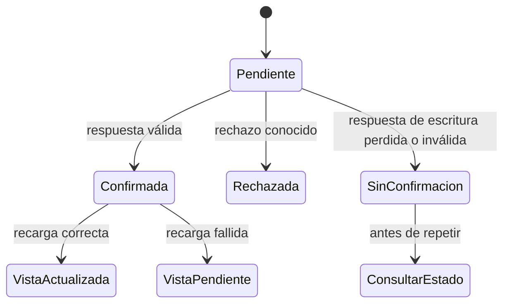

# Modelo conceptual del control de errores

Este piloto no crea tablas ni modelos persistentes. Describe los conceptos
observables que utilizan los contratos existentes.

| Concepto | Datos relevantes | Regla |
| --- | --- | --- |
| Respuesta | Estado HTTP, cabeceras, cuerpo, identidad cuando aplica | Validar antes de publicar datos; `204` puede carecer de cuerpo. |
| Error HTTP | `status`, mensaje, `code` opcional, `fieldErrors` opcional | Preservar lo recibido según el contrato y mostrar un mensaje útil. |
| Error de transporte | `code`, mensaje, `outcomeUnknown` | Distinguir timeout, conexión y cancelación; no reintentar escrituras automáticamente. |
| Estado de vista | Últimos datos válidos, borrador, carga, aviso | Un rechazo no publica éxito ni elimina trabajo del usuario. |

No todos los errores tienen todos los atributos. El contrato HTTP y los errores
construidos en el frontend son objetos distintos.

## Transiciones

La futura implementación de ERR-009 sitúa la cancelación posterior al envío de
una escritura en `SinConfirmacion`; la cancelación anterior al envío no crea
una operación remota. El diagrama describe el contrato deseado, no enums nuevos.
